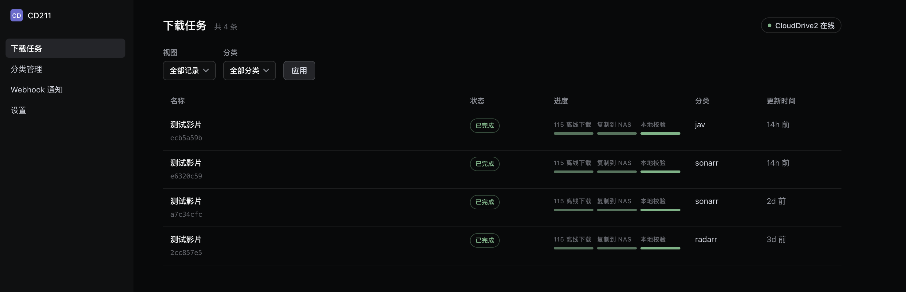

# CD211

[English](README_EN.md) | 简体中文

通过 **115 离线下载**，命中云端资源即可**秒下**。用 CD211 替代 qBittorrent 下载客户端，再由 CloudDrive2 将文件复制到 NAS。进度、重试和配置都在 Web 界面管理。

<p align="center">
  
</p>

## 准备

- 已挂载 115 的 CloudDrive2，并启用 gRPC 访问。
- Docker。
- CloudDrive2、CD211 和需要读取下载文件的工具共用的 NAS 暂存目录，各容器内挂载到**相同路径**，例如 `/downloads`。

## 快速开始

### 1. 启动

```sh
docker run -d --name cd211 --restart unless-stopped -p 8080:8080 -e PUID=99 -e PGID=100 -v cd211_data:/data -v "$PWD/downloads:/downloads" turygo/cd211:latest
```

CloudDrive2 需使用同一 `PGID`，并以 `umask 0002` 启动，让各服务能管理暂存文件。

### 2. 完成设置

打开 `http://<cd211-host>:8080`，按向导设置 `admin` 密码、CloudDrive2 连接、115 下载目录和暂存目录。没有默认密码。

随后创建分类，例如电视剧用 `tv`、电影用 `movies`，为每个分类选择云端和暂存子目录。

### 3. 配置下载客户端

在你的工具中添加下载客户端，类型选择 **qBittorrent**，填写 CD211 的连接信息：

| 字段 | 填写内容 |
|---|---|
| 主机 | CD211 的主机名或 IP |
| 端口 | `8080` |
| 使用 SSL | 关闭（使用 HTTPS 反向代理时开启） |
| 用户名 | `admin` |
| 密码 | 刚设置的密码 |
| 分类 | CD211 中已启用的分类，如 `tv` 或 `movies` |

连接测试通过后保存，即可正常提交下载。

支持密钥认证的工具也可使用 CD211 设置页生成的 qBittorrent API 密钥。

[更新记录](CHANGELOG.md)
